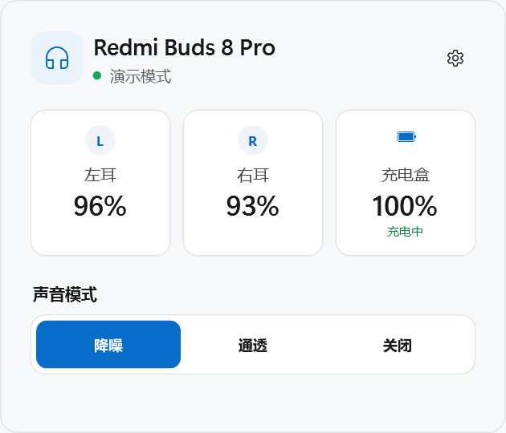

# Buds Tray

一个面向 Windows 11 的轻量蓝牙耳机托盘应用，按小米和万魔两类协议路由。已验证 Redmi Buds 8 Pro 和 1MORE SonoFlow S，拥有其中任意一台即可使用。没有 Electron、后台网页或遥测。可执行文件名保留 RedmiBudsTray.exe，以兼容已有自启动注册。

## 发行版兼容范围

- 首次安装没有已管理设备时显示“添加你的耳机”引导，不自动加入任何已配对设备。通过“设置 → 管理设备”或设备列表底部的“管理设备”，从 Windows 全部已配对设备中选择加入，也能移除。
- 面板只显示明确加入的设备；单设备不显示切换箭头，多设备显示已加入的列表。名称沿用当前 Windows 蓝牙设备记录。不因发现另一台同品牌耳机而自动加入，不依赖开发者的蓝牙地址。
- 升级旧版本时只迁移此前用户选中的一台耳机；不迁移整个品牌匹配列表。暂时失去配对记录的设备保留在管理页，仍可移除，不悄悄替换为别的设备。
- 加入第一台耳机且它已连接时自动附着控制通道；加入第二台且它已连接时单独进行只读识别，不改变当前选择或音频输出。添加操作不主动重连蓝牙，耳机未连接或此前被手动暂停时等待用户点击连接。移除只释放该设备的控制通道并从面板删除，保留 Windows 配对/蓝牙音频，不切换默认输出。移除最后一台重新显示添加引导，重启后也不自动补回。
- 添加页列出未加入的全部已配对设备；如果没有可选项，提供 Windows 蓝牙设置入口。改名的设备仍可加入，通过通信尝试识别协议。
- 小米/万魔为两套协议适配器，不使用型号白名单限制连接或声音模式试用。Redmi Buds 8 Pro 与 1MORE SonoFlow S 是已经做过真机测试的设备，并非仅允许这两个型号。
- 只对已加入设备尝试小米 FD2D/MMA 认证或万魔 SPP 信息查询，必须收到有效返回才确认协议；名称只是优先顺序提示。探测不修改耳机设置。
- 自动识别只读，不主动切换降噪/通透。只有实际返回该模式或用户点击试用并收到正确回读，才记录已确认能力；关闭状态、超时、未知返回值不自动判断不支持。未知能力默认允许用户试用，不按型号/PID猜测功能。
- 管理设备页点击设备名称进入“协议与功能”：可选自动 / 小米 / 万魔，可独立显示或隐藏降噪、通透按钮，可恢复自动。按设备保存；保存选项只改变本应用配置并重建必要的控制连接，不发送模式设置命令、不改变默认音频输出。
- 手动协议只尝试用户选定的协议，不在失败后悄悄换另一品牌。万魔允许在信息查询未被识别但 SPP 通道确实已打开时尝试控制；小米仍须完成必要的协议认证，手动选择不能绕过认证或让未打开的蓝牙通道变成可控制。
- 用户点击声音模式才发送该协议的设置命令，随后等待新查询/通知回读，SET ACK 不当作模式成功；失败会提示并恢复实际状态，不自动隐藏该功能。旧版本由型号表推测的能力缓存会清除，但设备名单、名称、连接暂停状态保留。
- 同品牌可能使用不同认证、服务 UUID、封包、电量布局和模式枚举，不承诺所有型号必然兼容。任何已配对设备均可加入并尝试，即使已改名或未出现在测试名单中。
- 管理页显示协议家族和已确认能力；未知字段隐藏。设备切换仍按用户明确选择同步 Windows 音频输出。

分发时请同时提供本包 GPL-3.0-only 许可证、第三方声明及对应源码包。配置保存在当前用户注册表，日志保存在当前用户 LocalAppData，均不随发行 ZIP 打包。请不要加入开发者电脑的配置、日志和蓝牙抓包。



## 已实现

当前维护分支恢复为 0.9.8 的非透明旧界面，后续 Fluent/模糊改版不启用。

0.9.8.5：删除型号/PID能力白名单与未验证型号禁用逻辑，增加按设备手动协议和声音模式按钮配置；模式切换等待真实回读，识别失败允许用户自行试用，不通过自动模式切换探测能力。

0.9.8.4：显式管理设备清单、首次安装添加引导、从全部已配对设备加入/移除、实际协议响应校验、VID/PID 型号能力识别与未知能力保留。管理清单按用户保存，移除不影响 Windows 配对和音频连接；保留旧版外观及页面动画。

0.9.8.3：中性默认名称、单设备界面、协议家族/型号能力分离、无设备配对入口、真实名称显示与未验证型号只读探测。保留原有已验证耳机的连接/断开/控制流程。

0.9.8.2：增加“设置 → 耳机设置”子页。读取 Redmi 固件、双设备状态、自适应降噪、自适应音效、自动接听及降噪时的强度。三个布尔开关只在读取到有效状态后显示，写入后必须收到实际查询/通知回读才确认；失败不假装成功。双设备为纯文本只读，避免修改造成蓝牙重启。未知或未返回的项目隐藏，无滚动条，保留旧版非透明外观与页面过渡。

2026-10-13 真机只读验证：Redmi VID/PID 2717/50E3，固件 1.3.6.3；双设备关闭、自适应降噪关闭、自适应音效开启、自动接听关闭。EQ 返回 0x15，与上游通用预设表不符，暂不显示也不写入。三个新开关的协议帧、解析及界面已测试，真实硬件写入尚未验证；本次测试未修改耳机配置。不开启未经验证的入耳检测硬件开关或 LDAC 设置。

0.9.8.1：音量白框扩大为整块点击/拖动区域（静音按钮和原生滑块手柄除外），纵向留白与右侧百分比区域也参与按横向位置映射。拖动期间捕获滑块鼠标，保留误关闭防护；松开、丢失捕获或关闭窗口时清理交互。已移除 WPF UI 依赖与所有系统背景材质调用。

0.10.0：接入 WPF UI 4.3.0（MIT）。按钮、设置开关、音量滑块、右键菜单采用库内控件模板；卡片、文字、描边与强调色使用 Fluent 主题资源并跟随系统主题。耳机图标改成中性黑/白，背景通过 WPF UI 系统 Mica 实现，不再叠加手调色层。Mica 提取壁纸色调，不是卡片后方窗口的实时透明模糊。保留现有托盘生命周期、连接策略、协议及音量写入逻辑；随包附带 WPF UI 许可与第三方声明。

0.9.10：亚克力背景改为中性灰白/深灰，使用 85% 中性色层抑制壁纸混色，取消偏蓝灰底色；内层卡片使用近实色的中性白/灰，边框减淡。保留轻微背景模糊，主面板与右键菜单同步。

0.9.9：声音模式不再随刷新/重新打开播放整块淡入；SonoFlow 不再误判每次刷新为刚连接。卡片耳机图标采用 Segoe Fluent Icons 填充矢量轮廓（26 DIP），禁用轮廓像素吸附。卡片与右键菜单采用 Windows 11 原生 Desktop Acrylic 加轻微明暗色调，保留普通 HWND 和窗口全不透明，不使用 AllowsTransparency 或窗口透明度动画。系统关闭透明效果、高对比度、旧系统或 DWM API 失败时回退实色。

0.9.8：自动收回由单一检测器处理，鼠标捕获/拖动期间不收回，记录卡片内按下的手势起点，释放后再判断外部点击。托盘按下时确定开关意图，避免失焦或动画完成后再次点击误重新打开。

0.9.7：设备列表增加 160ms 下滑淡入和 110ms 收拢过渡，预先保留设备行高，后台读取状态时不改变列表高度。设置内容在固定背景上使用 200ms 滑入淡入，返回时滑出并轻微淡入主页面。快速反向点击从当前透明度/位移接续，收回卡片会清理过渡；遵循 Windows 关闭动画设置。

0.9.6：卡片大小变化采用 240ms 缓入缓出动画，单一 WPF 时钟同步高度、内部卡片/间距和顶部位置，保持底边固定。中途切换从当前尺寸接续，收回/菜单/退出会取消旧尺寸动画；遵循 Windows 关闭动画设置。回归验证中间尺寸、底边位置、反向切换及动画期间收回。

0.9.5：Redmi 连接面板采用独立舒展布局，电量卡片恢复至 126 DIP 高度，增加区域间距，面板高度调整为 408 DIP；动态尺寸继续按工作区右下角定位并支持小屏缩放。SonoFlow 和离线面板保持 360 DIP。

0.9.3：SonoFlow 电量改为居中的矢量圆环，百分比置于中央，取消电量长条及外层矩形卡片，区分电量状态与音量滑块的视觉形态。深浅色预览已核对；连接及音量逻辑不变。

0.9.2：切换箭头紧跟耳机名称，名称按钮随内容收缩，与断开/设置按钮分开。SonoFlow 电量改为横向整宽卡片和电量条，移除中间重复耳机图标；压缩间距并加入音量卡片。音量使用所选耳机的 Windows 输出端点，支持滑块、键盘步进和静音，打开期间自动回读系统音量；拖动合并写入，切换设备丢弃旧目标待写值。SonoFlow 实机通过音量写入/回读和原音量、静音状态恢复；Redmi/深浅主题布局预览已核对。

0.9.1：顶部设备名称展开耳机切换列表，显示各自连接状态与当前选中设备。选择设备时切换控制通道及 Windows 的默认声音输出（控制台、媒体、通信三种角色），保留另一台耳机的蓝牙连接；输出设置失败会回滚已修改的角色。记住选中设备，手动断开暂停状态按设备保存。修复 SonoFlow 旧音频端点抛出 FileNotFoundException、提前终止有效端点操作的问题。双设备与 LDAC 配置改为纯文字状态行。真机通过两台同时连接的来回切换、SonoFlow 断开/暂停/重启/恢复、另一台保持连接及默认输出回读测试。

0.9.0：新增 1MORE SonoFlow S 标准 SPP 控制。优先选择 Windows 已连接的受支持设备，手动重连保留当前设备。头戴耳机显示单电量卡片；支持电量、固件、三种声音模式，双设备与 LDAC 开关只读（不代表当前 Windows 编码）。真机读取电量 60%、固件 1.0.1；降噪/通透/关闭均通过设置回读验证。双设备写入会中断蓝牙连接，自动恢复尚不稳定，暂不在 UI 开放写入。暂不支持 SonoFlow 系列其他型号、EQ、固件升级及佩戴信息；仍保留 Redmi Buds 8 Pro 支持。

0.8.8：左右耳卡片预留行显示已佩戴/未佩戴，充电时优先显示充电中；未知状态不显示，断线清空旧佩戴状态。读取 F3/0x000C 并处理 F4 主动通知，沿用现有前后台查询频率。Redmi Buds 8 Pro 真机验证：双耳佩戴为 0x0C，只摘右耳为 0x08。未佩戴不等同入盒；独立入盒状态暂未实现。

0.8.7：统一卡片与菜单生命周期为 Hidden/Opening/Open/Closing/Menu/Exited 状态。使用修订编号废弃旧动画、旧菜单动作；卡片和菜单互斥。取消独立收回计时器，单一可见期检查器负责外部点击及开合超时收尾。隐藏、菜单切换、显示器变化和退出统一清理；保持 UI 样式及蓝牙控制逻辑不变。

0.8.6：针对菜单打开主窗口时 RootVisual 父级冲突的崩溃，菜单动作延迟至输入/关闭事件完成后执行；托盘操作统一进入 WPF Dispatcher，窗口打开增加重入保护。首次显示前改由 WPF 管理位置和尺寸，不再先 EnsureHandle 再原生移动/缩放；动画结束后的窗口操作移出绘制回调。回归覆盖首次菜单打开、连续 40 次菜单/设置/卡片开合和非空白渲染检查。长期运行及多屏切换仍需验证。

0.8.5：修复卡片可能无法收回的问题。增加仅在卡片可见时运行的外部点击/前台窗口检测，以及不依赖绘制帧的收回兜底；收回及退出后停止检测，重新弹出会取消旧的收回任务。

0.8.4：修复右键菜单关闭期间触发失焦事件、重复 Close 导致闪退的问题。关闭入口增加重入保护，并对菜单操作、失焦、原生关闭及重复关闭补充生命周期回归测试。

0.8.3：托盘右键菜单改为 WPF 原生桌面控件实现的 Fluent 风格菜单，使用 DWM 圆角、不透明背景、深浅主题、图标与圆角悬停反馈；提供打开面板、设置和退出应用。支持方向键、Tab、Enter、Esc 和失焦关闭，按所在屏幕 DPI 缩放并限制在工作区内。主卡片位置及蓝牙控制逻辑不变。

0.8.2：控制通道保持常驻，接收线程使用 Winsock select 等待数据，取代 15ms 空轮询。面板打开时每 2 秒查询，打开时立即补查；收起后无上报时每 30 秒查询，有上报时延后但最长 60 秒补齐一次完整状态。Windows 音频连接状态仍每 2 秒检查，移到后台线程，保持托盘连接状态及时更新。仅在已发查询长时间无响应时判定控制超时，静默空闲不会触发重连；相同读数不重复通知界面。模式切换仍立即发送并回读。

0.8.1：升降动画改为跟随 WPF 绘制帧更新，只移动窗口、不重复设置尺寸；消除显示时的起点跳变，动画期间合并界面刷新。保持显示器工作区右下角定位，并遵循 Windows 关闭动画的设置。

0.8.0：连接按钮增加居中旋转指示和完成后的淡入过渡；面板跟随 Windows 应用主题，托盘图标跟随任务栏主题。启用 Per-Monitor V2 DPI，按点击所在显示器的工作区定位，并在空间不足时整体缩小。设置页新增默认关闭的低电量提醒：任一耳机或充电盒降至 20% 时提醒一次（启用后首次读到低电量也会提醒），充电期间不提醒；重复读数、断线重连和应用重启均去重。恢复至 25% 或开始充电后重新允许下一轮提醒。通知遵循 Windows 的通知/勿扰设置。

本版未更改蓝牙协议及连接控制逻辑；已通过 80 组屏幕坐标/缩放计算测试、低电量去重测试和深浅色界面预览。真实多屏混合缩放仍需现场验证。

0.7.1：撤回 0.7.0 的设备停用方案，移除管理员助手与权限弹窗。正常连接/断开只通过 Windows 蓝牙音频接口和控制通道完成，不再停用设备节点。此前在本机停用的节点已逐一恢复并验证；音频及电量读取恢复正常。手动断开后，本应用仍暂停主动重连，但不能保证阻止 Windows/耳机自身的回连行为。

0.6.1：自启动迁移为当前用户登录任务（延迟 20 秒，失败最多重试 3 次，支持电池供电），保留原设置开关并移除本应用旧 Run 项。按 Windows Container ID 同时匹配该耳机的音乐播放（A2DP）及免提麦克风（HFP），修复只按地址筛选时遗漏免提通道的问题。手动断开优先于尚未结束的连接请求；先等待音频驱动完成断开，必要时仅执行一次底层断开。后台只在 Windows 音频连接就绪时接入控制，不反复发起音频重连；控制失败采用最长 30 秒退避。诊断日志保存在 `%LOCALAPPDATA%\RedmiBudsTray\app.log`，不记录音频或蓝牙密钥。

0.6.0：断开按钮同时断开 Windows 蓝牙音频和 RFCOMM 控制通道；手动断开后暂停所有主动连接和控制查询，重启应用也保留暂停状态。点击连接先检查/恢复蓝牙音频、确认就绪，再认证控制通道。后台每 2 秒检查状态，增加连接超时、无响应检测及单实例保护；托盘图标反映实际蓝牙状态。

0.5.0：打开面板立即自动查询，显示期间每 2 秒更新电量及充电状态，后台每 15 秒刷新。移除手动刷新入口及底部状态小字；离线状态统一显示“未连接”；托盘改用黑色 Segoe Fluent Icons 耳机图标。

0.4.0：取消整窗透明度动画，改为卡片上升/下降；电量标签、百分比固定居中，充电状态使用独立预留行；自启动迁入设置页；断开连接显示统一空状态和连接按钮。

- 系统托盘图标、左键弹出面板、右键菜单和退出
- 自动从 Windows 已配对蓝牙设备中查找 Redmi/Xiaomi Buds
- Windows 11 Fluent 风格圆角面板、层次化卡片和不透明 DWM 窗口
- 左耳、右耳、充电盒电量及充电状态
- 降噪、通透、关闭三种模式
- 启动后保持 RFCOMM 控制通道常驻，模式切换即时反馈并异步回读
- 每 2 秒刷新状态；非手动断线后自动重连，也可点击“连接”立即重试
- 面板进入、模式滑块和电量变化动画
- 可在面板中开启或关闭“随 Windows 启动”
- `--demo` 演示模式，无耳机也能检查全部界面交互
- 响应耳机主动发起的二次认证请求，保持控制会话稳定
- 无第三方运行时包；发布版为自包含单文件

## 运行

直接运行发布目录里的 `RedmiBudsTray.exe`。首次使用前，请先在“Windows 设置 → 蓝牙和设备”中完成耳机配对，并暂时关闭手机上的 Xiaomi Earbuds App，避免它占用耳机的私有控制通道。

演示界面：

```powershell
RedmiBudsTray.exe --demo
```

## 技术选择

最长期、最“纯”的新应用路线是 WinUI 3；但系统托盘仍主要依赖 Win32。这个最小版本使用 .NET 8 WPF + 原生 `NotifyIcon`/DWM：启动快、部署简单、无需 Electron，同时保持 Fluent 化外观。协议层与 UI 分离，后续可以把面板迁移到 WinUI 3，而不重写蓝牙代码。

## 协议实现

蓝牙音频连接使用 Windows `KSPROPSETID_BtAudio` 的单次连接/断开请求，按耳机蓝牙地址匹配音频拓扑，不改变默认输出、不删除配对、不禁用服务/驱动。断开音频后通过 `IOCTL_BTH_DISCONNECT_DEVICE` 关闭该耳机剩余链路。请求返回成功后仍核对实际连接状态。手动暂停只约束本应用，不阻止用户在 Windows 设置中连接，也不控制其他应用或耳机自身的连接行为。

控制通道使用 Xiaomi MMA 私有协议：

1. 从系统注册表读取已配对设备名称和蓝牙地址。
2. 用 WinSock2 打开 `AF_BTH` / RFCOMM 通道。
3. 优先通过服务 UUID `0000FD2D-0000-1000-8000-00805F9B34FB` 让 Windows 执行 SDP；失败后尝试固定通道 6。
4. 执行 opcode `0x50` / `0x51` 的挑战应答认证。
5. 用 `0x02` 查询三路电量；用配置项 `0x000B` 查询/设置降噪状态。

MMA 帧和兼容认证实现参考 GPL-3.0 项目 TWS-Pods-PC；Buds 8 Pro 实际使用的新认证分支与能力表来自 BudsLink；电量与型号映射参考了 MIT 项目 BatteryMonitor。详情见 [THIRD_PARTY.md](THIRD_PARTY.md)。

## 验证状态

2026-09-15 补充：登录任务已实际拉起发布版，但尚未重启电脑验证登录触发。延长断开测试观察到，即使本应用已暂停且未发送连接命令，Windows 的 A2DP/HFP 端点仍可能在约 55 秒后自行恢复。因此目前不能保证系统层面永久断开；本应用不会用持续强制断开与系统互相争抢连接。

| 能力 | 当前状态 |
|---|---|
| 托盘、弹窗、按钮、演示数据 | 已实现并完成界面预览 |
| MMA 认证算法 | 已通过上游 36 组二进制真值向量 |
| 电量请求帧与解析 | 已通过已知字节向量 |
| 降噪请求帧与解析 | 已实现，协议层可编译 |
| Windows 已配对设备枚举 | 已在 Redmi Buds 8 Pro 真机验证 |
| Redmi Buds 8 Pro RFCOMM/FD2D SDP | 已在真机验证；Windows 可自动解析并连接 |
| Buds 8 Pro 挑战应答认证 | 已在真机验证，兼容两套已知认证明文 |
| 左/右/盒三路电量 | 已在真机读取验证 |
| 蓝牙音频及控制通道断开/重连 | 已真机验证完整往返；断开后 8 秒轮询及新控制器启动均未自动重连 |
| 降噪 → 通透 → 降噪控制与回读 | 已完成真机往返验证 |
| 不同固件/地区型号的兼容性 | **需要真机验证** |

本次真机测试确认 Buds 8 Pro 不使用 Buds 6 Play 的固定通道 6，但 FD2D UUID 的 Windows SDP 解析可以成功找到实际服务。失败提示会区分“设备未找到”“RFCOMM 连接失败”“认证未通过”“已连接但未收到状态”。

## 构建

需要 .NET 8 SDK：

```powershell
dotnet build RedmiBudsTray.sln -c Release
dotnet publish RedmiBudsTray.csproj -c Release -r win-x64 --self-contained true -p:PublishSingleFile=true
```

## 许可证

由于认证算法实现衍生自 GPL-3.0-only 代码，本项目整体以 GPL-3.0-only 发布。Redmi、Xiaomi 等名称仅用于兼容性说明，本项目与小米公司无隶属或认可关系。
